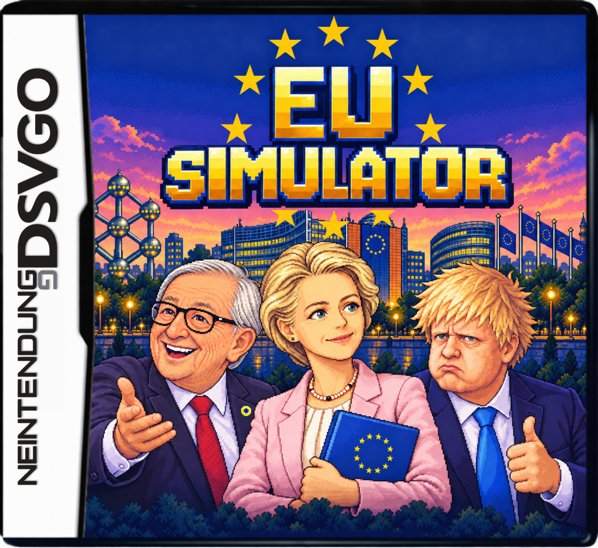
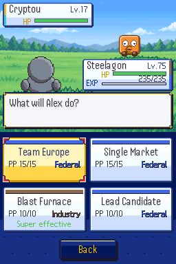
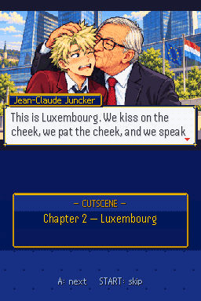
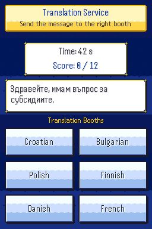

# EU Simulator

<p align="center">
  <strong><a href="https://eusim.fabs.lu/">🌐 Website</a></strong> ·
  <strong><a href="https://eusim.fabs.lu/play.html">🎮 Play in your browser</a></strong>
</p>

<p align="center">
  <a href="https://eusim.fabs.lu/">
    
  </a>
</p>

A parody RPG for the **Nintendo DS**, set in and around the European Union. You are an unpaid intern at the European Parliament with an ambitious goal: get the directive ending daylight saving time adopted. Collect treaty badges, debate Euromons, survive late-night summits, and negotiate your way through Europe's institutions.

> **⚠️ 🤖 AI-generated.** This game was quickly generated using **Claude Opus 5.5** and **GPT-6.1 Sol**. It is an experimental prototype with limited validation. Its code, dialogue, translations and political references can contain mistakes and rough edges. AI-generated artwork and music, their tools, and third-party material are documented in [CREDITS.md](CREDITS.md).

The game is an unofficial parody. It is not affiliated with the European Union, its institutions, Nintendo or The Pokémon Company.

## Inside the game

- Explore European cities and institutions, earn eight treaty badges, and collect 100 Euromons.
- Learn something on every street: Syntagma's Evzones, the Bock casemates, Strasbourg's storks, the Schuman Declaration's Salon de l'Horloge, Budapest's baths, and more. Each local reference comes with its context.
- Meet political caricatures, watch illustrated cutscenes, and play 21 touch-screen mini-games, from translation booths and plenary votes to loading a container ship in Piraeus.
- Find the ECB's secret studio in Frankfurt and get your own portrait engraved on a specimen of the next euro banknotes: photo with the DSi camera, stylus drawing or official portrait.
- Play in any of the **24 official EU languages** (written in English, translated into the 23 others).
- Multiplayer offers online rooms and nearby wireless play.

|   |   |   |
| :---: | :---: | :---: |
|  |  |  |

## Build the ROM

These commands run from the root of this folder/repository. The website, deployment credentials and relay source are not needed for a normal ROM build.

### Requirements

- Linux, macOS, or Windows through WSL with a POSIX shell.
- **Python 3.10 or newer**, a virtual environment, and the packages in [requirements.txt](requirements.txt).
- **ffmpeg** on `PATH`, used to convert the included music.
- **Docker** with permission to run containers, or a native **BlocksDS** installation with `BLOCKSDS` configured.
- A host C compiler (`cc`) to run the regression tests.

The build script uses the official [BlocksDS Docker image](https://blocksds.skylyrac.net/docs/setup/docker/) when it cannot find a native installation. See the [BlocksDS installation guide](https://blocksds.skylyrac.net/docs/setup/) for platform-specific setup.

### Recommended: Docker toolchain

For Debian/Ubuntu or WSL, install the host dependencies, then activate a Python environment:

```sh
sudo apt-get update
sudo apt-get install -y python3 python3-venv ffmpeg build-essential

python3 -m venv .venv
. .venv/bin/activate
python3 -m pip install -r requirements.txt
```

Install/start Docker using its instructions for your operating system. With Docker available to your user:

```sh
docker pull skylyrac/blocksds:slim-latest
./build.sh
```

The result is **`EU_Simulator.nds`** in the repository root. Python generates the bundled game data and assets on the host; BlocksDS compiles and packages the ROM inside Docker. The required artwork, fonts, music, scripts and translations are included. Building does not regenerate artwork with an AI service.

### Native BlocksDS

With the SDK environment loaded and `BLOCKSDS` set:

```sh
. .venv/bin/activate
./build.sh
```

The same script selects the native toolchain automatically. `BLOCKSDS_IMAGE` can select another Docker tag or digest when using the Docker fallback.

### Development builds and tests

```sh
# Regenerate data/assets without compiling the ROM
python3 tools/build_assets.py

# Run the host-side game regressions; requires cc
python3 -m unittest discover -s tests -v

# Skip the opening and enter test scenario 2 in German
SCEN=2 QLANG=de ./quick.sh
```

The quick build writes `eusim_quick.nds`. Run the asset generator before the tests on a fresh checkout; it creates the generated ID tables used by the tests. Host-side tests do not replace testing graphics, audio, saving and wireless behavior on real hardware.

## Source layout

| Path | Contents |
| --- | --- |
| `source/`, `include/` | C engine, UI, battle logic, saving and DS networking |
| `assets/` | Artwork, fonts, music, map sources, dialogue scripts and translations |
| `data/` | Euromon, move, trainer and item definitions |
| `tools/` | Asset generators and build helpers |
| `tools/capture/` | Optional headless screenshot tooling; separate from the normal build |
| `tests/` | Host-side game regression tests |
| `docs/` | Screenshots, game/design documentation and attribution notices |
| `midi/` | Additional music source material and MIDI exports |

## Licence and credits

- **Code:** [GNU GPL v3 or later](LICENSE).
- **Game content:** [CC BY-SA 4.0](LICENSE-ASSETS.txt), except third-party material with its own notices.
- **Fonts and third-party assets:** retain their original licences and attributions.

Read [COPYING.txt](COPYING.txt) and [CREDITS.md](CREDITS.md) before redistributing. These notices also apply to modified versions and compiled ROMs.
